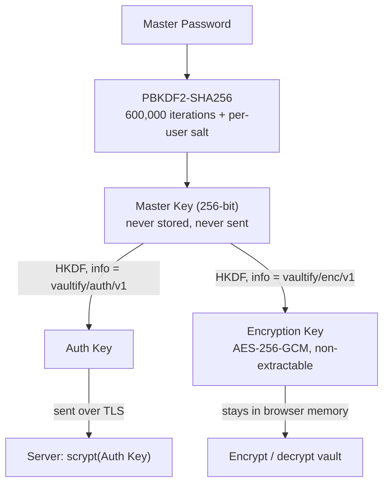
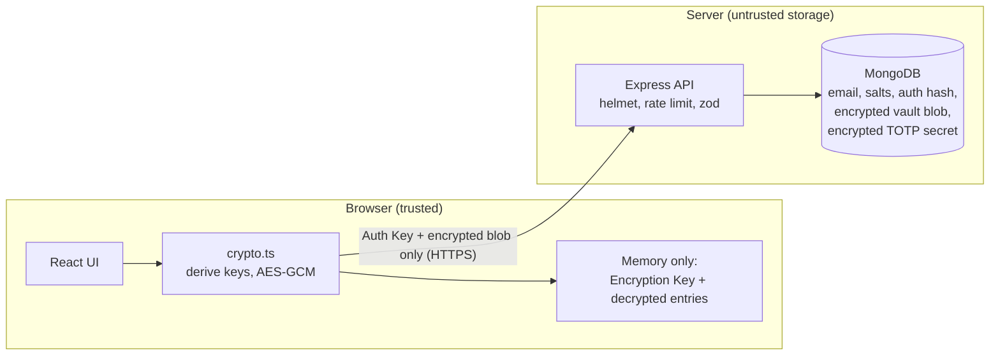

# Architecture

## Dual-key derivation

## Where encryption happens

The line between the two boxes is the zero-knowledge boundary. Plaintext passwords, the Master Password and the Encryption Key never cross it.

## Login flow

1. Client asks `GET /api/auth/salt?email=...` and receives the KDF salt.
2. Client derives the Auth Key and Encryption Key locally.
3. Client sends the Auth Key (and a TOTP code if 2FA is on) to `POST /api/auth/login`.
4. Server verifies scrypt(Auth Key), issues a 30-minute JWT.
5. Client fetches the encrypted blob with `GET /api/vault` and decrypts it in the browser.